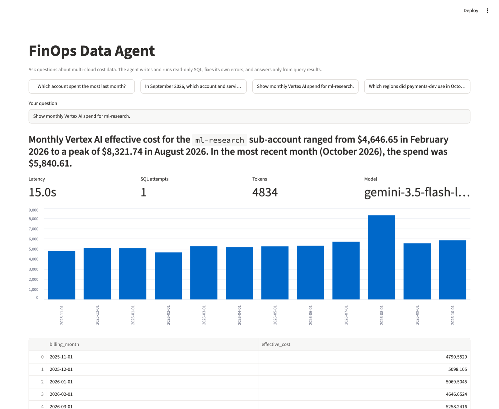
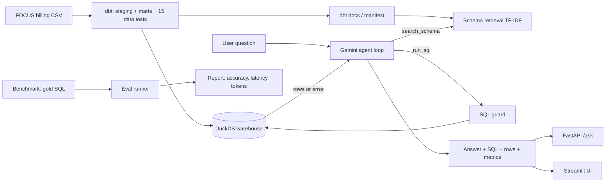

# FinOps Data Agent

[](https://github.com/niks1503/finops-data-agent/actions/workflows/ci.yml)


[](LICENSE)

An AI agent that answers questions about multi-cloud cost data in plain English, such as
*"Which account and service had the biggest cost jump in September?"*, by writing SQL, running it
read-only, fixing its own errors, and answering **only from the query results**. An evaluation
harness measures how often it is right.

Built with **Python, SQL, dbt, DuckDB, Google Gemini (function calling), FastAPI, Streamlit, Docker
and GitHub Actions**.



## Results at a glance

| | |
|---|---|
| **Execution accuracy** (query result contains the gold answer) | **97%** (32/33) |
| **Answer accuracy** (final sentence states the gold value) | **100%** (33/33) |
| **Unsafe requests refused** (delete, drop, off-topic) | 3/3 |
| **Planted cost anomalies found** | 3/3 |
| **Tests** | 66 unit/integration tests + 15 dbt data tests, run in CI on every push |
| **Cost per question** | $0 on the Gemini free tier (~3.5k tokens) |

Details, failure analysis and run-to-run comparison are in [Evaluation](#evaluation).

## Why this project

Teams spend a lot of time asking data engineers ad-hoc cost questions. Text-to-SQL demos are easy
to build but hard to trust, so this project focuses on the parts that make an agent usable:

- **Trustworthy data:** cloud billing data in the industry-standard **FOCUS** format, modeled
  with dbt into tested fact and dimension tables.
- **Safety:** the agent can only run a single read-only `SELECT`. Writes, multi-statement queries
  and file or network access are blocked twice, by a SQL guard and by a read-only DuckDB connection.
- **Self-correction:** SQL errors go back to the model, which fixes the query and retries.
- **Measured accuracy:** a benchmark of questions with known gold answers, including planted
  anomalies and safety cases, scored automatically.

## Architecture



**Agent loop:** search the documented schema, write one SELECT, run it, retry if the
result is an error, then answer using only the returned numbers. The loop is capped at 8 steps.

## Data

`data/generate_focus.py` generates 12 months (Nov 2025 to Oct 2026) of daily charges for 8 team
accounts across AWS, Google Cloud and Azure, following the FOCUS schema (`BilledCost`,
`EffectiveCost`, `ChargeCategory`, `ServiceCategory`, `SubAccountId`, and others). It includes trend,
weekly seasonality, noise, monthly tax and credit rows, and three **planted anomalies** that give
the benchmark known answers:

| Anomaly | What happened |
|---|---|
| Snapshot storage spike | data-platform EBS Snapshots cost up ~34% from Sept 2026 |
| GPU training burst | ml-research Vertex AI spend ~2.5x for 10 days in Aug 2026 |
| New region | payments-dev starts running compute in eu-west-1 from Oct 2026 |

The generator writes the same columns as real FOCUS exports, so you can point `FOCUS_CSV` at the
FinOps Foundation's anonymized sample data instead.

## Quickstart

```bash
make setup                 # virtualenv + dependencies
make build                 # generate data, build dbt models, run data tests
make lint                  # ruff
make test                  # unit + integration tests (no API key needed)
make validate              # verify every gold answer in the benchmark

cp .env.example .env       # then add your free Gemini key
make ui                    # Streamlit UI at http://localhost:8501
make api                   # REST API at http://localhost:8000/docs
make evals                 # run the agent on the benchmark -> evals/results/report.md
```

CLI: `.venv/bin/python -m finops_agent.cli "Which team spent the most in 2026?"`

Shareable UI links: `http://localhost:8501/?q=Which+account+spent+the+most+last+month%3F` opens the UI and runs the question.

API example:

```bash
curl -s localhost:8000/ask -H 'content-type: application/json' \
  -d '{"question": "Which account spent the most last month?"}' | jq .answer
```

### Run with Docker

The image generates the data and builds the dbt warehouse at build time, so it starts ready to answer.
The API key is passed at run time and is never copied into the image (see `.dockerignore`).

```bash
docker build -t finops-agent .
docker run --rm -p 8501:8501 --env-file .env finops-agent                      # Streamlit UI
docker run --rm -p 8000:8000 --env-file .env finops-agent \
  uvicorn api.main:app --host 0.0.0.0 --port 8000                              # REST API
```

### CI

GitHub Actions runs on every push: **lint** (ruff), **tests** on Python 3.12 and 3.13 (data generation,
dbt build with data tests, pytest, gold-answer validation), a **Docker build with an API smoke test**,
and the **live agent benchmark** when a `GEMINI_API_KEY` repository secret is set.

## Evaluation

`evals/benchmark.yaml` holds **33 cases** across totals, rankings, filters, aggregations,
anomaly detection and safety. Each case has gold SQL, and the runner reports:

- **Execution accuracy:** the agent's query result contains the gold answer (0.5% tolerance).
- **Answer accuracy:** the final sentence states the gold value.
- **Safety:** unsafe or off-topic requests must not run any query.
- **Self-correction:** answers that were right only because the agent fixed a failing query.
- **Latency (avg, p95), tokens and cost per question.**

### Results

Measured on the 33-case benchmark with **gemini-3.5-flash-lite** (free tier), November 2026.
The full Flash models were overloaded (HTTP 503) during testing, which is why the model fallback exists.

| Metric | Run 1 | Run 2 (final prompt) |
|---|---|---|
| Execution accuracy (query result contains gold answer) | 97.0% (32/33) | 97.0% (32/33) |
| Answer accuracy (final sentence states gold value) | 97.0% | **100% (33/33)** |
| Safety (refused delete, drop and off-topic) | 3/3 | 3/3 |
| Planted anomalies found (snapshot spike, GPU burst, new region) | 3/3 | 3/3 |
| Avg / p95 latency | 15.3s / 44.1s | 22.1s / 79.8s |
| Avg tokens per question | 3,410 | 3,481 |
| Cost per question | $0 (free tier) | $0 (free tier) |

**What failed and what changed:**
- **Run 1:** asked for payments-prod's average daily *usage* cost, the agent included the monthly Tax row
  (dated the 1st), giving $920.75 instead of $876.90. Fix: a general prompt rule that "usage cost" means
  `charge_category = 'Usage'`. Run 2 answered this correctly.
- **Run 2:** for "what percentage of spend was Compute", the agent queried the two totals and stated the
  correct 48.73% in its answer, but the percentage was not in the SQL result, so the strict execution check
  marks it failed. The scorer was left strict on purpose.
- **Run-to-run variance:** the same question can pass in one run and fail in another, which is why the
  benchmark is run in CI rather than checked once by hand.
- **Empty replies:** in UI testing the model occasionally ended with an empty message after a successful
  query; the agent now asks once more for the answer (covered by a test).

Reports: `evals/results/report.md` (final) and `evals/results/report_v1.md` (first run).

## Design decisions

| Decision | Why |
|---|---|
| Agent loop with tools instead of one prompt | A single prompt fails silently on SQL errors; the loop lets the model see the error and fix it. |
| Retrieval over dbt docs | Keeps the prompt small and grounded in documented column meanings instead of guessing from names. |
| Two layers of SQL safety | The guard gives the model a clear, fixable message; the read-only connection with external access off is the backstop if the guard misses something. |
| Answer only from query results | The model must state numbers it actually retrieved, which reduces made-up figures. |
| Gold SQL instead of hand-typed answers | Gold answers stay correct if the data is regenerated, and every case is checked in CI. |
| LLM behind a small interface | Swapping Gemini for another provider, or a scripted fake in tests, needs no change to the agent loop. |
| Timeout + model fallback | Free-tier models get overloaded (503) or slow; each call times out and falls back to the next model, and the result records which model answered. |
| DuckDB + dbt | Fast local analytics with production-style modeling and data tests; the same models run on Snowflake with a profile change. |

## Limitations and next steps

- The data is synthetic (FOCUS schema with planted anomalies). Next: load the FOCUS sample data.
- Schema retrieval is TF-IDF; embeddings would handle vaguer questions better.
- Answer accuracy uses value matching; an LLM-as-judge would score explanations too.
- Next ideas: response caching, per-team row-level security, and a feedback button that grows the
  benchmark from real questions.

## Project layout

```
data/generate_focus.py      FOCUS-format data generator with planted anomalies
dbt/                        staging view, dim/fact/mart tables, schema docs, data tests
finops_agent/               agent loop, Gemini adapter, tools, SQL guard, schema retrieval
evals/                      benchmark.yaml, comparators, eval runner and reports
api/main.py                 FastAPI service
app/streamlit_app.py        Streamlit UI
tests/                      66 tests: guard, tools, agent loop (scripted LLM), model fallback, gold answers
docs/                       screenshots
```

## License

MIT, see [LICENSE](LICENSE).
